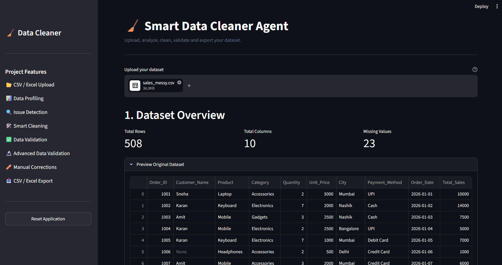
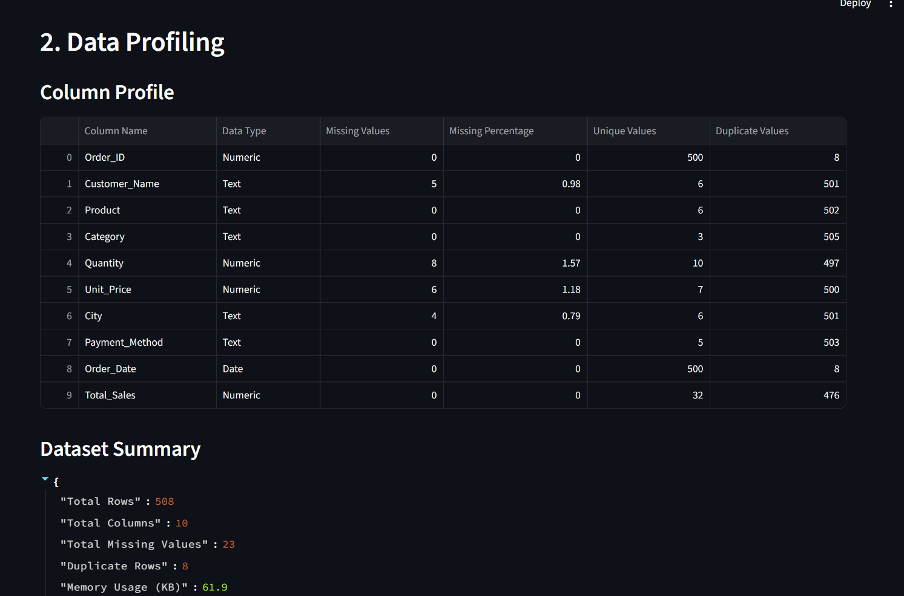
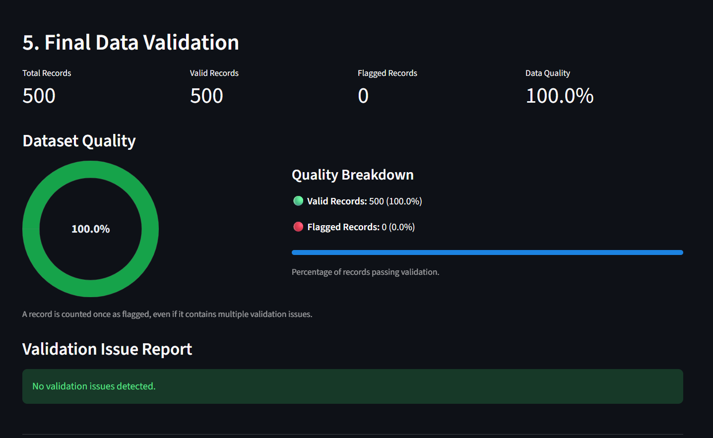
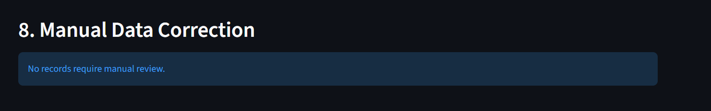
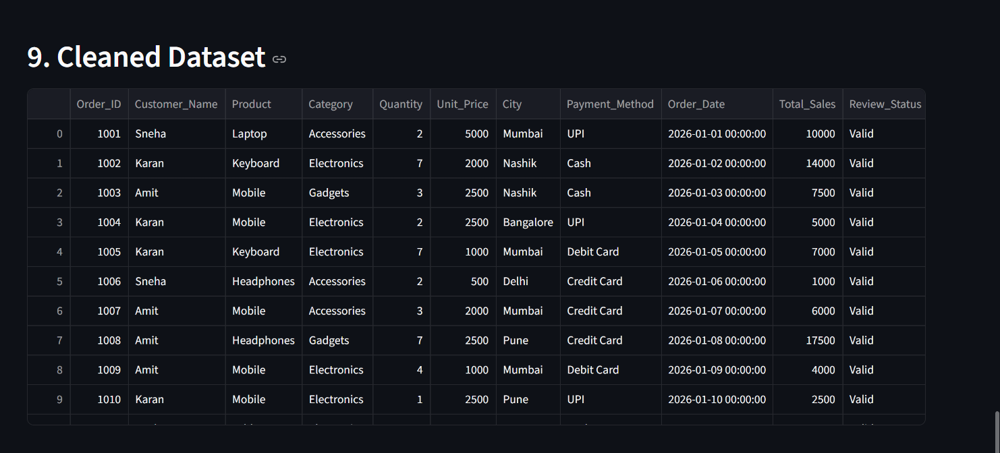
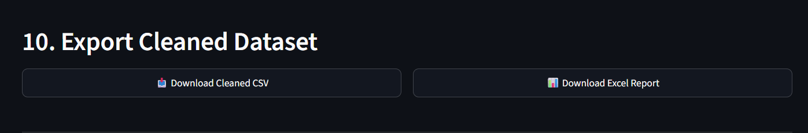

# Smart Data Cleaner Agent

A rule-based data cleaning and validation web application built with
Python, Pandas, NumPy, and Streamlit.

The application helps users inspect a dataset, identify data-quality
problems, review recommended cleaning actions, correct flagged records,
validate the results, and export cleaned data.

> **Note:** This project uses predefined cleaning and validation rules.
> It does not use Artificial Intelligence or Machine Learning.

## Features

-   Upload CSV and Excel datasets.
-   Preview and profile uploaded data.
-   Identify missing values, duplicate records, inconsistent text,
    invalid dates, and invalid numerical values.
-   Review data-cleaning recommendations and approve supported actions.
-   Validate records using predefined rules.
-   Inspect flagged records in a manual-review section.
-   Edit supported fields and revalidate the dataset.
-   Export cleaned data and validation reports to CSV and Excel.

## Technology Stack

  Technology    Use
  ------------- --------------------------------
  Python        Application logic
  Pandas        Data manipulation and cleaning
  NumPy         Numerical operations
  Streamlit     Interactive web application
  Plotly        Data visualizations
  OpenPyXL      Excel file support
  CSV / Excel   Input and output formats

## Project Structure

``` text
Data_Cleaner_Agent/
├── Data/
│   └── sales_messy.csv
├── Notebooks/
│   └── Data_cleaning.ipynb
├── output/
│   └── (exported cleaned datasets and reports)
├── app_smart.py
├── cleaning_engine.py
└── README.md
```

Your local folder may contain additional backup or test files. Upload
only the files needed to run and understand the project.

## Getting Started

### 1. Clone the repository

Replace `YOUR_GITHUB_USERNAME` with your GitHub username:

``` bash
git clone https://github.com/YOUR_GITHUB_USERNAME/Smart-Data-Cleaner-Agent.git
cd Smart-Data-Cleaner-Agent
```

### 2. Install dependencies

``` bash
python -m pip install pandas numpy streamlit plotly openpyxl
```

### 3. Run the application

``` bash
python -m streamlit run app_smart.py
```

### 4. Open the local dashboard

Streamlit will display a local address in the terminal. Usually:

``` text
http://localhost:8501
```

Keep the terminal running while using the application.

## Application Workflow

1.  Upload a CSV or Excel dataset.
2.  Review the dataset overview and data profile.
3.  Inspect detected data-quality issues.
4.  Review and approve available cleaning recommendations.
5.  Run data validation.
6.  Review flagged records.
7.  Correct records using the manual correction section.
8.  Save corrections and revalidate.
9.  Export the cleaned dataset and reports.

## Sample Dataset and Results

The project was demonstrated using a sales dataset containing 500
records.

After manual review and correction, the application's final validation
screen showed:

  Metric              Result
  ----------------- --------
  Total records          500
  Valid records          500
  Flagged records          0
  Data quality          100%

These figures describe the demonstrated run on the sample dataset.
Results will vary with other uploaded datasets.

## Important Data-Correction Note

Automated validation can identify suspicious or invalid values, but it
cannot always determine the correct business value. Verify corrections
against a trusted source before saving them. Do not assume that a
calculated value is correct unless its input fields are confirmed.

## Future Improvements

-   Cleaning history and audit logs.
-   Before-and-after data-quality comparison.
-   Additional configurable validation rules.
-   More detailed downloadable quality reports.
-   Improved dashboard usability and visualizations.

## Author

**Adarsh Subhash Patil**

B.Tech -- Electrical Engineering

Areas of interest: Data Analytics, Python, Data Cleaning, and Data
Visualization.

------------------------------------------------------------------------

If you find this project useful, you can star the repository on GitHub.


---

## Application Screenshots

### 1. Dashboard Overview


### 2. Data Profiling


### 3. Final Data Validation


### 4. Manual Data Correction


### 5. Cleaned Dataset


### 6. Export Cleaned Dataset

